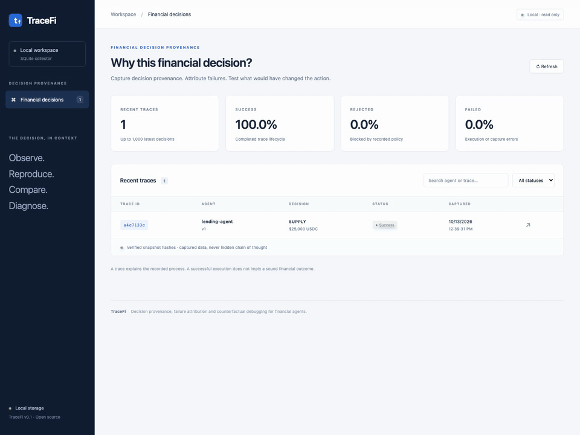
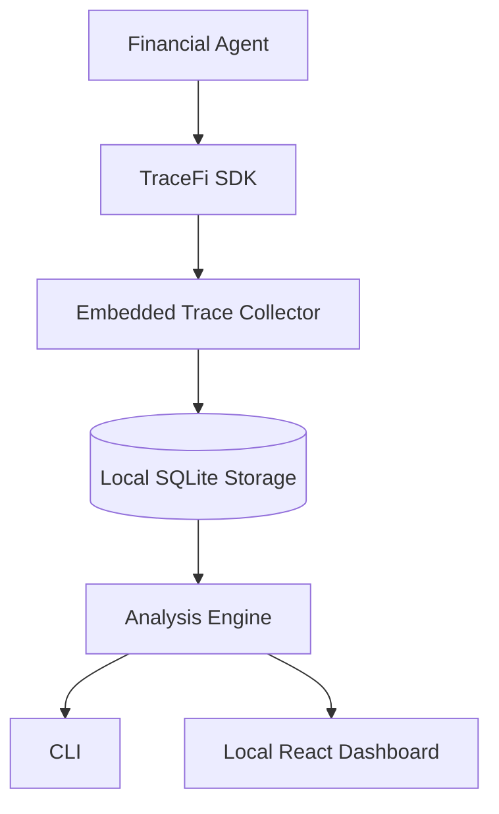

# TraceFi

**Decision provenance, failure attribution and counterfactual debugging for financial agents.**

A position lost money. Was the input stale, a risk signal omitted, a policy
bypassed, execution unsuccessful—or was it simply a negative market outcome?
TraceFi links the recorded state, evidence, proposal and controls, then tests
**what input would have changed the decision**.

Observe → reproduce → compare → diagnose.



[75-second recorded demo](docs/assets/tracefi-demo.webm) ·
[Case study](docs/FINANCIAL_CASE_STUDY.md) · [Reproduction commands](docs/DEMO.md)

## Quick Start

Python 3.10+. No runtime Python dependencies, API keys, model, cloud service or
real funds. The installed examples and dashboard work offline.

```bash
git clone https://github.com/Dparini/TraceFi.git
cd TraceFi
python3 -m venv .venv
source .venv/bin/activate
pip install -e .
tracefi demo --case-study
tracefi analyze latest
tracefi serve
# Open http://127.0.0.1:8765
```

Install from this repository or a verified GitHub release. TraceFi has **not**
been published to PyPI; an identically named package may be unrelated.
[Full quickstart and CLI exit codes](docs/QUICKSTART.md).

```python
from tracefi import TraceFi

with TraceFi() as collector:
    with collector.decision("yield-agent", "1", portfolio={"USDC": 100_000}) as t:
        t.capture_context({"apy": 0.067, "liquidity": 21_000_000})
        t.capture_decision({"action": "SUPPLY", "asset": "USDC", "amount": 25_000})
        t.capture_policy({"approved": True})
        t.capture_simulation({"success": True, "mode": "synthetic"})
        t.capture_execution({"status": "success", "mode": "synthetic"})
    print(t.trace_id)
```

The SDK observes caller-supplied checks; it does not enforce policy on an external
executor. Record the actual inputs and structured decision factors, never hidden
chain-of-thought. [API and JSON contract](docs/API.md).

## Architecture



The collector is synchronous and in-process. SQLite stores redacted snapshots,
spans and artifacts with canonical SHA-256 integrity checks.
[Architecture and compatibility](ARCHITECTURE.md).

## Main capabilities

- **Provenance:** independent input snapshots, retrieved evidence, structured
  proposals, nested spans, policy/simulation/execution results and outcomes.
- **Replay and diff:** explicitly selected adapters, full structured output
  comparison and changed inputs. A match does not prove global determinism.
  [Replay](docs/REPLAY.md).
- **Failure attribution:** observed inconsistencies, likely explanations,
  multiple findings and unknowns. Loss alone does not establish agent error.
  [Attribution](docs/FAILURE_ATTRIBUTION.md).
- **Counterfactuals:** isolated single-input interventions and bounded numerical
  search with diagnostics for sampled ambiguous/non-monotonic transitions.
  Sensitivity is conditional, not causal proof. [Counterfactuals](docs/COUNTERFACTUALS.md).
- **Regression testing:** identical scenarios, proposal validity, repeated-output
  consistency, policy rejections, exposure and explicitly modeled costs; configurable
  CI gates. [Regression testing](docs/REGRESSION_TESTING.md).
- **Inspection and export:** verified trace explorer, timeline, safe rendering,
  standalone HTML and JSON exports that refuse existing output filenames.

## Financial case study

A synthetic $100,000 USDC portfolio compares two lending markets. Protocol B
reports 6.7% APY and $21M liquidity, but its −41% daily liquidity trend is omitted
from the retrieved agent context. A $25,000 supply passes the exposure policy
and immediate execution simulation; a later, explicitly assumed stressed exit
records a $1,821 loss.

TraceFi preserves the omitted evidence. Restoring that one trend changes the
proposal to $20,000 on Protocol A. This demonstrates conditional sensitivity;
it does not prove the original decision irrational or predict the alternative's
financial outcome. [Assumptions and complete investigation](docs/FINANCIAL_CASE_STUDY.md).

```bash
tracefi replay latest --adapter lending-v1
tracefi counterfactual latest --adapter lending-v1 \
  --feature context.markets.protocol_b.liquidity_trend_24h --value -0.41
tracefi eval --baseline lending-v1 --candidate lending-v2 --dataset lending
```

Thirty generic fault scenarios and eight lending scenarios ship with the package.
The original `tracefi demo` and `agent-v1`/`agent-v2` regression workflow remain available.

## Security and limits

Default/configured secret field names and explicit `collector.secret(value)`
wrappers are redacted before storage and hashing. Unknown secrets in free text
require caller handling. New DBs and exports are private on creation; DB symlinks
are refused. The dashboard binds loopback and validates Host/Origin.

Hashes are consistency checks, not signatures or a tamper-proof log. Adapters
are trusted Python code, not sandboxed executors; built-in agents have no financial
execution capability. JSON is bounded and strictly parsed. Exact replay of
redacted state is refused. Numerical boundaries retain an unproven monotonicity
assumption even after sampling.

v0.1.0 targets a sequential local collector. Distributed ingestion, live financial
execution, validated returns/drawdown, signed logs and statistical determinism
proofs are outside its scope. Optional Ollama transport has mock security tests;
live model behavior is not qualified. There is no trading recommendation engine,
exchange, token or blockchain component.

[Security guide](docs/SECURITY.md) · [Threat model](THREAT_MODEL.md) ·
[Limitations](docs/LIMITATIONS.md) · [Measured benchmarks](docs/BENCHMARKS.md) ·
[Contributing and validation](CONTRIBUTING.md) · [Release notes](docs/RELEASE_NOTES.md)

MIT licensed. No paid service is required.
